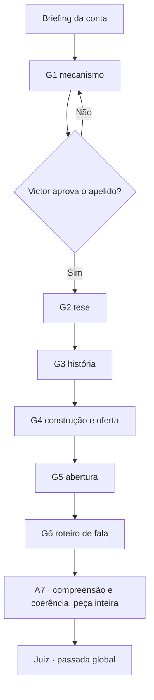

# MÉTODO — PRODUÇÃO DE VSL POR AGENTES

> **Tipo:** método · secundário: gate (§5), trilho (§3)
> **Instituído:** 02/10/2026 · alçada Victor (*"aprovo, pode fazer"*) · ✅ **VIGENTE** — ~~🟡 vigência provisória~~ retirada pelo Victor no mesmo dia (*"tire o método de 'provisório', implemente o que precisa ser implementado e acabou"*). **Exceção declarada ao `CLAUDE.md` §7.1, item 4, por alçada do dono:** a primeira VSL (conta Débora) deixa de ser condição de vigência e passa a ser **a primeira revisão** — o que ela mostrar entra como versão nova deste arquivo (`CLAUDE.md` §8, REGRA Nº 1).
> **Galho de:** `METODO-FUNIL-DE-VSL.md` (é a forma de executar a escrita do roteiro) · usa `METODO-MECANISMO-E-ONE-BELIEF.md`, `METODO-PONTOS-LOGICOS.md`, `METODO-DESTILACAO-DE-VSL.md` e a skill de copy
> ⟲ **Revisão 1 (16/10/2026, alçada Victor), pelo primeiro uso (VSL da Débora): §5 e §6 reescritos, §8 novo.** Gate de fato antes do G1 · estrutura-base com função e tempo · A7 também sobre a estrutura · orçamento por rodada · auditoria proporcional · juiz não reabre decisão do dono.
> **Os agentes:** fonte em `900-criação-implementação-victor/agentes-vsl/` · publicados em `.claude/agents/` (`vsl-*.md`, 13 arquivos). **Edita-se na oficina e copia-se para a publicação, nunca o inverso.**

---

## 1. POR QUE EXISTE

**Três fatos, de 02/10/2026:**

1. **A skill de copy previa o "modo delegado" e ninguém o disparava.** Os 9 papéis estavam escritos; o roteador não obrigava, e na prática a VSL era escrita e auditada **no mesmo contexto** — exatamente o que a skill diz que falha: *"auditoria colada na escrita vira justificativa."*
2. **Os 9 papéis são genéricos de copy.** Uma VSL modelada exige verificações que nenhum deles fazia: **dose e sequência contra a referência medida**, **cadeia de causa e efeito elo a elo com a fronteira promessa × efeito**, e **gravabilidade** pelo expert.
3. **O pacote de agentes do Tiago Filemon** (`900-criação-implementação-victor/VSL/Pack de Prompts - Imersão VSL Filemon.pdf` — Raio X, Mechanism Lab, Logic Points, Story Architect, Lead, Offer Builder) trouxe o que faltava do lado da **geração**: **um especialista por bloco, formulário de entrada, e esqueleto aprovado antes do texto**, na ordem inversa de leitura. **O que ele não tem é auditoria** — e é o que a casa tem.

> **A síntese:** geradores especializados à maneira do Filemon + auditores isolados à maneira da casa + um juiz que só decide.

**O que fica de fora do pacote do Filemon, e por quê:** o **Raio X** gera o público *"específico e visceral"* sem fonte — é exatamente o erro da conta Bárbara Rosa. **O público vem do `lexico-icp/` e da arqueologia, com grau.**

---

## 2. OS 14 AGENTES *(13 até 16/10/2026; + A7)*

| # | Agente | Faz | Equivale no Filemon |
|---|---|---|---|
| G1 | `vsl-g1-mecanismo` | mecanismo do problema e da solução · candidatos a apelido · One Belief | Mechanism Lab |
| G2 | `vsl-g2-tese` | a cadeia de pontos lógicos + a fronteira promessa × efeito | Logic Points |
| G3 | `vsl-g3-historia` | a história do expert, na dose da base | Story Architect |
| G4 | `vsl-g4-oferta` | construção + oferta com a pilha done-for-you real | Offer Builder |
| G5 | `vsl-g5-abertura` | a abertura, por último | Lead |
| G6 | `vsl-g6-roteirista-fala` | o texto vira roteiro gravável | — **(nosso)** |
| A1 | `vsl-auditor-estrutura` | sequência e dose contra a base medida | — |
| A2 | `vsl-auditor-causalidade` | encadeamento, destino, teto da promessa, pivô | — |
| A3 | `vsl-auditor-procedencia` | origem de toda fala, cena, número e depoimento | — |
| A4 | `vsl-auditor-voz` | voz do expert, léxico da conta, gravabilidade | — |
| A5 | `vsl-auditor-antislop` | gate anti-slop da skill de copy | — |
| A7 | `vsl-auditor-compreensao` | 🔴 **a VSL inteira, como o ouvinte frio, com a linha do tempo falada:** em que segundo fica claro o que é (o método/veículo), para quem é, por que ouvir, o que se compra · e a coerência da peça (eixo, nível de consciência, prova, verdade operacional, congruência com o produto da expert). **Instituído 16/10/2026** | — |
| A6 | `vsl-auditor-cetico` | o público desconfiado — relata, não veta · 🟡 **+ leitura de retenção linha a linha** (08/10/2026, em teste na Débora, blocos 2 e 4) | — |
| J | `vsl-juiz` | consolida, devolve, decide · passada global no fim | — |

---

## 3. O FLUXO



**Cada caixa de G2 a G5 é um ciclo inteiro:**

1. o gerador entrega o **esqueleto** → **o Victor aprova** (ou o orquestrador, se o Victor delegar)
2. o gerador entrega o **texto**
3. **A1 a A6 em paralelo, cada um em contexto próprio** — recebem o texto, o briefing e a rubrica; **nunca o raciocínio do gerador**
4. **o juiz** consolida e devolve; **teto de duas devoluções**
5. bloco aprovado → próximo gerador

**Depois do G6, e em toda revisão de lead ou de oferta:** o orquestrador gera a linha do tempo falada de cada funil (`py -I -X utf8 40-operacao-rotinas/ferramentas/tempo-vsl.py <roteiro> <pasta>/TEMPO-<versão>-FUNIL-B.md` e `--funil a`) e dispara o **A7** sobre a peça inteira. O laudo dele vai ao juiz na passada global. *(Instituído 16/10/2026: na VSL da Débora, o veículo do curso só ficava claro aos 14 minutos, e nenhum auditor de bloco tinha como ver isso.)*

**Ordem de trás para frente** (`METODO-FUNIL-DE-VSL.md`): mecanismo → tese → história → oferta → abertura. **A abertura por último**, porque só então o mapa existe.

---

## 4. O QUE O ORQUESTRADOR FAZ

O orquestrador é o agente principal (o CEO, nesta casa). Ele **não escreve nem audita peça**.

| Antes | Durante | Depois |
|---|---|---|
| monta o **briefing da conta** (`clientes/<cliente>/.../vsl/BRIEFING-VSL.md`) a partir do repositório — **o cliente não preenche formulário** | dispara cada agente com: o caminho do briefing, os artefatos anteriores aprovados, o arquivo de saída | registra na conta (`DECISOES`, diário) e no swipe file quando houver dado · 🔴 **gera a composição da VSL (§4.4)** |
| confirma as **pré-condições** (§5) | leva o esqueleto ao Victor · roda os 6 auditores **em paralelo** · leva os relatórios ao juiz | aplica o gate de congruência com declaração de carga |

**Onde os artefatos moram:** `clientes/<cliente>/12 - Direct Response/vsl/<AAAA-MM-DD>/` — um arquivo por papel e por ciclo (`G2-TESE.md`, `A1-BLOCO-3.md`, `JUIZ-BLOCO-3.md`…). **Nada se apaga: a trilha é a prova de que cada peça foi auditada.**

> ✅ **Testado em 02/10/2026 (Cowork) — origem do §4.1 e do §4.3:** os agentes de `.claude/agents/` **não são reconhecidos** como tipo (*"Agent type 'vsl-auditor-estrutura' not found"*). **O disparo por arquivo funciona:** um agente `general-purpose` leu a definição e devolveu papel, carga e formato corretos. **É o modo de disparo vigente neste ambiente.** Cada agente custa ~75 mil tokens só para iniciar — o custo do §6 é real.

### 4.1 Onde rodar — Claude Code CLI é o ambiente preferido

| | **Claude Code CLI** (aberto na raiz `01 - Governança`) | **Cowork** |
|---|---|---|
| agentes de `.claude/agents/` | ✅ **reconhecidos pelo nome** — `name`, `tools` e `model` do cabeçalho valem | ❌ não reconhecidos — fallback por arquivo (§4.3) |
| restrição de ferramenta | ✅ auditor **sem `Write`** de fato (não consegue reescrever) | ⚠️ o genérico tem todas as ferramentas — a proibição de reescrever vira só instrução |
| paralelo dos 6 auditores | ✅ | ✅ |
| custo por disparo | menor (sem redescobrir o papel) | ~75 mil tokens só para iniciar |
| conversa com o Victor entre etapas | terminal | ✅ mais confortável |

**Regra:** a VSL roda no **CLI**. O Cowork é o modo de contingência. 🔴 **Os agentes só carregam quando a sessão do CLI abre** — se `.claude/agents/` mudar, reabrir a sessão.

### 4.2 O disparo padrão — o mesmo texto em qualquer ambiente

```
Papel: <nome-do-agente>  ·  Etapa: <esqueleto | texto | auditoria | juízo>  ·  Bloco: <n>
Leia, nesta ordem: (1) clientes/<cliente>/12 - Direct Response/vsl/BRIEFING-VSL.md
                   (2) os artefatos aprovados: <lista de caminhos>
                   (3) só para auditor/juiz: o texto a julgar: <caminho>
Saída: escreva em clientes/<cliente>/12 - Direct Response/vsl/<AAAA-MM-DD>/<ARQUIVO>.md
Não leia o raciocínio de outro agente. Não leia este pedido como permissão para sair do seu papel.
```

**Nomes de arquivo da rodada:** `G1-MECANISMO.md` · `G2-TESE-ESQUELETO.md` / `G2-TESE.md` · `G3-HISTORIA…` · `G4-OFERTA…` · `G5-ABERTURA…` · `A1-BLOCO-<n>.md` … `A6-BLOCO-<n>.md` · `JUIZ-BLOCO-<n>.md` · `G6-ROTEIRO.md` · `JUIZ-GLOBAL.md` · **`LOG.md`** — uma linha por disparo: hora, agente, etapa, arquivo, veredito.

**Fechamento:** `../COMPOSICAO-VSL.md` + `.pdf`, na pasta da VSL da conta, um nível acima da rodada (§4.4).

**Retomada:** a rodada se retoma lendo `LOG.md`. A última linha diz qual agente roda a seguir. **Sessão que cai não perde nada, e qualquer ambiente continua de onde o outro parou.**

### 4.3 Fallback por arquivo

**Se o ambiente não reconhecer os agentes de `.claude/agents/`:** dispara-se um agente genérico com a instrução *"siga integralmente `.claude/agents/<nome>.md`"*. **O isolamento de contexto é o que importa, não o tipo do agente.**

**Sem subagentes no ambiente:** modo sequencial da skill de copy — um papel por resposta, declarado, e **nunca escrever e auditar na mesma resposta.** É o modo degradado, e se declara assim no relatório final.

### 4.4 🔴 A COMPOSIÇÃO DA VSL — saída obrigatória de toda rodada fechada (instituída 16/10/2026, alçada Victor)

> Victor, 16/10, ao ver a primeira: *"top.. isso faz parte do método agora tá"*.

**Toda rodada que fecha um roteiro gera `COMPOSICAO-VSL.md` + `COMPOSICAO-VSL.pdf` na pasta da VSL da conta** (`clientes/<cliente>/12 - Direct Response/vsl/`, um nível acima da rodada), **com três páginas: duas de estrutura e ⟲ uma de função** *(16/10, Victor: "composição agora precisa ter uma página a mais, explicando o que cada coisa FAZ")*: **cada elemento, o segundo em que entra (pela linha do tempo) e o que o ouvinte passa a saber, sentir ou decidir ali**, e uma linha comparando os marcos com a referência. Versão nova do roteiro, composição nova, sobrescrevendo a anterior (a trilha fica no LOG).

**O que ela tem, nesta ordem:** cabeçalho (versão do roteiro, data, estrutura-base, palavras e minutos por funil, formato) · promessa, mecanismo e apelido, e o pivô **E · Mas · Por isso**, uma frase cada, com o elemento da virada · **tabela bloco → sequência de elementos → o que cada um faz, em uma linha → palavras** · a abertura alternativa (funil A) em uma linha · o que ficou fora da versão, os desvios de dose declarados e o estado (grava? mídia? escala?).

**Como se faz, e por quem:**
1. **Script** (mecânico): `py -I -X utf8 40-operacao-rotinas/ferramentas/composicao-vsl.py <roteiro G6> <pasta-da-vsl>/COMPOSICAO-VSL.md <TEMPO-funil-B.md>` — com a linha do tempo, ele já monta a página 3 com o tempo de cada elemento — blocos, elementos e contagem, calibrada contra o roteiro (3.496 no v3 e 3.536 no v4.2 da Débora, idênticos ao rodapé).
2. **Orquestrador** preenche os `{{…}}`: a função de cada elemento em uma linha e as frases de promessa, mecanismo e pivô — **tiradas do roteiro e do juízo global, nunca inventadas.**
3. **PDF** pelo template da casa (`90-templates/pdf-continuum/`, sem capa; no Windows, o contorno `pdf_chrome.py` da rodada da Débora). **Conferir que coube em duas páginas**, abrindo a página renderizada.

**Por que existe:** depois de dezenas de arquivos por rodada, ninguém — nem o Victor, nem o próximo agente — enxergava a peça inteira de uma vez. A composição é o mapa de uma página que diz o que a VSL é, sem abrir o roteiro. **Exemplo de referência:** `clientes/Débora Delgado/12 - Direct Response/vsl/COMPOSICAO-VSL.pdf`.

---

## 5. PRÉ-CONDIÇÕES E VETOS

**Não se dispara o G1 sem:**
- pilares **P1 e P4 passando** (`METODO-TESTE-DE-PILARES.md`)
- **estrutura-base medida** — a referência escalada destilada elemento a elemento (`METODO-DESTILACAO-DE-VSL.md`) · ⟲ **16/10: com `função` e `tempo` por elemento e a linha do tempo de compreensão** (Etapas 5 e 7). Sem isso, o gerador copia o rótulo sem saber o trabalho do elemento, e o A7 mede contra limite inventado
- 🔴 ⟲ **16/10 · GATE DE FATO: nenhuma lacuna de fato aberta.** Cada `[[ FALTA ]]` sai **decidido** (REGRA Nº 0, quando é estrutura), **contornado** com o que o repositório já tem, **cortado**, ou **respondido** antes do primeiro gerador. *Origem: na Débora, as rodadas 1 e 2 (02 a 13/10) foram escritas com 24 lacunas abertas e terminaram as duas em "não grava"; a rodada 3, depois de "não perguntamos mais nada, contornamos", fechou em um dia.*
- 🔴 ⟲ **16/10 · A7 SOBRE A ESTRUTURA:** a estrutura da conta (`ESTRUTURA-VSL-*.md`) e os esqueletos passam pelo **A7 em modo estrutura** (nível de consciência, veículo, eixo e congruência com o produto da expert) **antes de qualquer texto**. *Origem: o nível de consciência errado e a crítica ao produto da Débora nasceram na estrutura de 30/09 (D01 e D05) e só foram pegos no texto, três rodadas depois.*
- **briefing** com promessa e teto, oferta com a pilha real, falas com ID e grau, regras de linguagem e skill de voz

**Régua de veto (vai na tabela do gate de congruência):**
- 🔴 VSL **escrita e auditada no mesmo contexto** quando o ambiente tem subagentes
- 🔴 bloco aprovado **sem os seis relatórios**
- 🔴 auditor que **reescreve**
- 🔴 texto escrito **antes do esqueleto aprovado**
- 🔴 bloco que segue com defeito de **procedência** ou de **promessa acima do teto** (nunca seguem, nem no teto de devoluções)
- 🔴 **rodada fechada sem `COMPOSICAO-VSL.md` + `.pdf` na pasta da VSL** — duas páginas de estrutura + uma de função (o que cada elemento faz, e quando) (§4.4, 16/10)
- 🔴 **G1 disparado com lacuna de fato aberta**, ou com estrutura-base **sem função e tempo** (16/10)
- 🔴 **rodada acima do orçamento (§6) sem reporte ao Victor antes de seguir** (16/10)
- 🔴 **juiz que reabre decisão registrada do dono** sem subir a divergência ao Victor (16/10)
- 🔴 **peça gravada sem o laudo do A7 sobre a versão final**, ou com veto do A7 aberto: o ouvinte frio não sabe **em até 1:00 o que é** (o veículo), **em até 1:30 para quem é**, ou descobre o produto **só na oferta** · afirmação de disponibilidade/prazo falsa contra o briefing · crítica ao que a própria expert vende (16/10)

---

## 6. CUSTO E ORÇAMENTO *(reescrito 16/10/2026, revisão 1)*

~~Seis gerações em duas etapas + seis auditorias por bloco nos quatro blocos centrais + passada global ≈ 35–40 execuções de agente.~~ **Medido na primeira VSL (Débora, 02 a 16/10): cerca de 290 disparos registrados em três rodadas, e uma segunda conta para terminar.** O desenho estava certo no isolamento e errado na proporção. Cada agente custa de 75 mil a 300 mil tokens só para ler o contexto.

**Orçamento por peça:**

| Etapa | Agentes | Teto |
|---|---|---|
| Bloco **novo** (texto que não existia) | gerador + **A2, A3, A4** em paralelo + juiz · A1 e A5 **por script** sempre que possível (contagem e léxico) · A6 só na peça inteira | 1 ciclo + 1 devolução |
| **Delta** (troca de frases numa peça já auditada) | **um gerador** + **A3** (procedência) + **o auditor do que a troca toca** (A4 se há fala nova; A2 se muda a cadeia; A7 se mexe em lead ou oferta) | 1 ciclo · a segunda reprovação **fecha por corte**, nunca por nova rodada |
| **Peça inteira** | **A7** (compreensão e coerência) + juiz na passada global | 1 |
| **Mecânico** (contagem, montagem, PDF, composição, linha do tempo, diff) | **script**, nunca agente | — |

🔴 **Passou do teto, para e reporta ao Victor** com o custo até ali e o que falta. Nunca segue por conta própria.

**Para baratear sem perder o isolamento:** o briefing único, os auditores em paralelo, e **um gerador só para um delta que atravessa blocos** (ele carrega as regras dos geradores envolvidos), em vez de um por bloco.

---

## 7. O QUE ESTE MÉTODO NÃO FAZ

Não escolhe a referência (isso é a `METODO-DESTILACAO-DE-VSL.md`), não decide promessa nem oferta (decisões do Victor, registradas antes — `REGRA Nº 0`), e **não dispensa a revisão pelo primeiro uso**: a primeira VSL produzida por ele (Débora) tem o `LOG.md` lido no fim — devolução recorrente, auditor que nunca reprova ou etapa pulada viram versão nova deste método.

---

## 8. REVISÃO 1 — o que a primeira VSL ensinou (16/10/2026)

> O §7 manda ler o `LOG.md` da primeira VSL no fim: *"devolução recorrente, auditor que nunca reprova ou etapa pulada viram versão nova deste método"*. Trilha: `clientes/Débora Delgado/12 - Direct Response/vsl/2026-10-02/LOG.md` e `2026-10-11/LOG.md` · conversa: `2026-10-11/TRANSCRIPT-SESSAO-2026-10-15-16.md`.

| # | O que aconteceu | O que mudou |
|---:|---|---|
| 1 | Duas rodadas escritas sobre 24 lacunas de fato que a cliente não ia responder; as duas terminaram em "não grava" | gate de fato antes do G1 (§5) |
| 2 | A estrutura copiou o rótulo `contrarian` da referência sem saber o que ele fazia para o ouvinte; o lead nasceu falando a quem já conhece o Eneagrama | destilação com função e tempo (`METODO-DESTILACAO-DE-VSL`, Etapas 5 e 7) · o gerador recebe o trabalho do elemento |
| 3 | A peça criticava o produto da própria expert (teste de comportamento); seis auditores de bloco e dois juízes não viram | auditor **A7**, peça inteira, também sobre a estrutura (§2, §3, §5) |
| 4 | O veículo do curso só ficava claro aos 4:45, e o produto aos 14 min | o A7 mede por tempo, contra a linha do tempo da referência |
| 5 | Cerca de 290 disparos e uma segunda conta | orçamento e auditoria proporcional (§6) |
| 6 | O juiz reabriu decisões do dono (o burnout entrou, saiu e voltou a ser discutido) | juiz não reabre decisão registrada do dono (§5) |
| 7 | O gerador "explicou por que não" em vez de executar uma decisão de estrutura | o disparo de delta leva as decisões como contrato; gerador não decide estrutura |
| 8 | Ninguém via a peça inteira | composição da VSL em 2 páginas (§4.4) |
