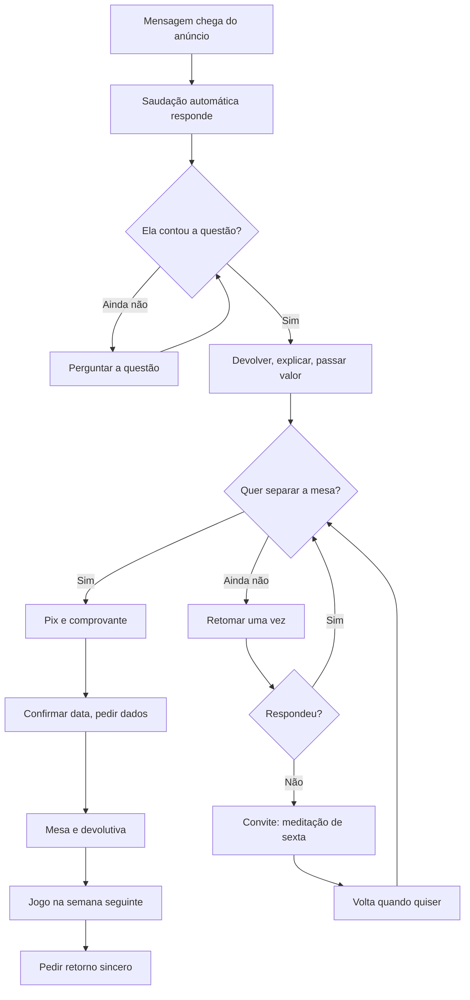

# PROCESSO COMERCIAL DO WHATSAPP · Paola Lopes Rosa · Mesa Arcturiana

> **Tipo:** registro (processo da conta) · **Feito em:** 12/10/2026 · **Pedido:** Victor (*"agora faz o processo comercial do WhatsApp dela"*) · compromisso N-5 da call de 11/10
> **Base:** `PILARES.md` P4 (*"como aparece"*, passo 2) e P3 (objeções) · `DESTILACAO-CALL-2026-10-11.md` · `METODO-SALESFORCE-INBOUND.md` (a primeira resposta vende o próximo passo) · skill de copy, módulo 04 (calibração de WhatsApp)
> **Voz das mensagens:** da Paola. Ela ainda não leu; tem direito de objeção de congruência (REGRA Nº 0).
> **Status:** 🟡 **estrutura decidida; metade das mensagens depende de fato dela.** Dá para usar hoje a saudação, a pergunta da questão, a explicação da mesa e três respostas de objeção. **Valor, Pix, confirmação e convite do grupo só funcionam depois das respostas do §2.**



---

## 1. As decisões de estrutura, e por quê

| Decisão | Por quê |
|---|---|
| **Venda por mensagem, sem call e sem agendamento** | o atendimento é à distância e sem horário (C-06); marcar chamada para vender criaria o embate de horário que ela quis evitar |
| **A primeira resposta dela já leva a explicação e o valor**, em três mensagens seguidas | o anúncio prometeu *"te explico como funciona e te passo o valor"*; e ela responde em janelas, então cada ida e volta a mais custa horas |
| **No chat ela escuta e explica. A leitura acontece na mesa** | ela capta rápido (*"Eu já estou captando tudo. Só de você falar comigo. Eu já entendi o que está acontecendo"*, `[19:54:24]`). Ler a pessoa na conversa é entregar o atendimento antes de vender, e quem recebe de graça não valoriza (C-47) |
| **A lista do que entrega é colada, nunca digitada de cabeça** | é o que faz a oferta ser a mesma em toda conversa (P4) |
| **Explicação e objeção podem ir em áudio; valor, Pix e confirmação vão sempre em texto** | a voz dela é o melhor material que ela tem (C-50); número e data precisam poder ser relidos |
| **Uma retomada só. Depois, o convite da sexta** | quem não compra não se perde, vai para o grupo gratuito (DEC-PL-07, C-30). E ela não gosta de venda direta: insistir não é dela |
| **Sem desconto na conversa** | preço que muda de uma conversa para outra apaga o único dado que a primeira semana gera. Se o preço mudar, muda para todas, no balanço semanal |
| **Três janelas de resposta por dia, e etiqueta em toda conversa** | um celular só, vida pessoal no mesmo aparelho, e ela disse: *"se vir um volume de pessoas. Eu já me perco nas mensagens. Aí mistura porque eu tô com um celular só."* (`[20:40:10]`, R-6) |
| **Depois do jogo, ela pede retorno sincero e autorização** | hoje não existe depoimento da mesa (R-3). Ela já pede retorno honesto de quem atende; aqui vira rotina |

**Descartado:** robô ou automação de resposta (o volume de um teste de R$ 200 não pede ferramenta, e processo vem antes de ferramenta) · pedir licença antes de passar o valor (uma ida e volta a mais) · mandar depoimento na conversa (não há da mesa; os mais fortes são de outra técnica, C-27) · prometer o mentor (C-21).

## 2. O que ela precisa responder para o processo fechar

Fato é pergunta. Cabem num áudio só.

| # | Pergunta | Destrava |
|---|---|---|
| 1 | Qual é o preço da mesa com o jogo incluído? *(F1)* | `/valor`, `/pix` |
| 2 | Como a pessoa paga: Pix em qual chave? Parcela? *(F3)* | `/valor`, `/pix` |
| 3 | Como você devolve a mesa (áudio, texto, chamada) e como é o jogo (ao vivo ou gravado, quanto dura)? *(F3)* | `/confirmado` |
| 4 | O que você precisa da pessoa para fazer a mesa, além da questão? Nome completo, data de nascimento, foto? | `/confirmado` |
| 5 | A comunidade de quem compra: é o seu grupo de hoje ou um novo? O que acontece lá? *(F2)* | `/valor`, `/confirmado` |
| 6 | Meditação de sexta: que horas, e qual é o link do grupo gratuito? | `/grupo` |
| 7 | Quando alguém pergunta *"e se eu não sentir nada?"*, o que você responde hoje? | objeção sem resposta com fonte |

Também: o vídeo do código Harmonia foi gravado? · quais são os três horários do dia em que você olha o WhatsApp?

## 2-bis. O que ela já respondeu *(12/10/2026, 17h03 a 17h36)*

Registro inteiro em `RESPOSTAS-PAOLA-2026-10-12.md`. **Fechado:** pagamento (Pix e link da InfinitePay) · o que precisa da pessoa (foto recente, nome, data de nascimento) · devolutiva em áudio · jogo ao vivo, em chamada · fila por ordem de pagamento. **Preço: R$ 287, inicial** (confirmado pelo Victor em 12/10, depois das 17h47). Uma linha de *"a partir de [data], R$ Y"* só entra se ela definir a data e o novo valor. **Fechado pelo Victor em 12/10, em seguida:** cartão em até 12 vezes, que é o padrão da InfinitePay · jogo de **1 hora** · a comunidade é **o grupo dela, com a oração e meditação ao vivo de sexta** (DEC-PL-17). **Aberto, e são só links e horários:** link do grupo e hora da sexta · link do Harmonia · link da InfinitePay · *"e se eu não sentir nada?"* · horários dela.

**Sobre texto ou áudio**, que ela perguntou: as mensagens prontas vão em texto, porque a pessoa lê no trabalho e no ônibus. Pergunta que a pessoa fizer, ela responde em áudio curto, com a voz dela.

## 3. As mensagens

Os colchetes são o que ela preenche. Tudo o que não está em colchete é fato já dito por ela.

### 3.0 Saudação automática *(dispara sozinha na primeira mensagem)*

🔴 **13/10/2026: com o atendimento por IA ativo (DEC-PL-23), esta saudação não se usa.** A frase *"Sou eu mesma que respondo"* vira falsa. A abertura passa a ser a do agente: *"Aqui é o atendimento da Paola Rosa."* O texto abaixo só vale se o agente estiver desligado. Material do agente: `agente-ia/LEIA-ME.md`.

```text
Oi! Aqui é a Paola. Sou eu mesma que respondo, então pode demorar um pouquinho.

Se você ainda não me contou, me diz: quais questões você quer levar para a mesa? Se já contou, já já eu te respondo.
```

### 3.1 `/questao` · quando ela chegou sem dizer a questão

```text
Antes de te explicar como funciona, me conta: quais questões você quer levar para a mesa? Pode ser do jeito que vier.
```

### 3.2 A primeira resposta dela: três mensagens seguidas

**Primeira, escrita na hora, nunca colada.** Uma linha devolvendo a questão **com as palavras da pessoa**. Sem interpretar, sem dizer de onde vem.

> Modelo: *"Oi, [nome]! Entendi: [as questões, do jeito que ela escreveu]. Vou te explicar como eu trabalho isso."*

**Segunda, `/mesa`:** 🔴 **substituída em 14/10/2026 por três bolhas curtas (`/mesa1` a `/mesa3`), a pedido dela (*"que gere esse desejo"*): texto e porquê em `MSG-PAOLA-2026-10-14.md` §J.** A versão abaixo fica como histórico.

```text
A Mesa Arcturiana é uma mesa radiônica multidimensional que eu canalizei. Funciona assim:

1. Você me traz as questões que quer tratar.
2. Antes de tratar, eu meço a sua aura e os seus 7 chakras: o quanto a aura está aberta, o tamanho, a cor de base, e quais chakras estão em desequilíbrio.
3. Na mesa eu equilibro a aura e os chakras com as geometrias arcturianas e vou atrás da raiz de cada questão: onde ela está alojada e a que outras vivências da sua alma ela ainda está ligada.
4. Você recebe a devolutiva em áudio, com tudo o que eu medi e o que apareceu.

Na semana seguinte a gente faz um jogo completo de baralho cigano, ao vivo, numa chamada de 1 hora. É para dar direção: a mesa faz a parte dela, e a sua parte é agir.

A mesa é à distância. Você não precisa estar presente.
```

**Logo depois, a arte dela** (`03 - criativos/criação da Paola/`), que mostra as duas etapas. *(12/10: decisão em `RESPOSTAS-PAOLA-2026-10-12.md` §4.)*

**Terceira, `/valor`:** ✅ fechada em 12/10. Falta só o link do vídeo do Harmonia, para tirar o colchete da linha dele

```text
O valor é R$ 287 e inclui:

• a Mesa Arcturiana sobre as suas questões, com a devolutiva em áudio
• o jogo completo de baralho cigano, ao vivo, na semana seguinte
• [um vídeo meu ensinando a ativar o código Harmonia, que você recebe na hora]
• a entrada no meu grupo, com oração e meditação ao vivo toda sexta

Pode ser no Pix ou no cartão em até 12 vezes, pelo link de pagamento. No cartão entram os juros do próprio link.

Eu faço duas mesas por dia, por ordem de pagamento. Depois do pagamento, a sua devolutiva chega em até 3 dias úteis.

Quer entrar na fila desta semana? Se sim, eu te mando a chave.
```

**O fecho é uma pergunta de sim ou não, de propósito.** Ela disse que não gosta de perguntar *"se você tem alguma dúvida"* (áudio das 17:36), e tem razão: essa pergunta convida a pessoa a procurar uma. A do fecho só pede a decisão.

As linhas do vídeo e da comunidade só entram quando existirem. Linha que promete o que não existe sai.

### 3.3 `/pix` · quando ela disse sim 🔴 depende de 1 e 2

```text
Combinado! A chave Pix é o meu celular: 21 98974-8565, em nome de Paola Cristina Lopes Rosa, no valor de R$ 287.

Se preferir no cartão, o link é este: [LINK DA INFINITEPAY]

Me manda o comprovante aqui que eu já te coloco na fila.
```

⚠️ **Dado pessoal:** a chave é o telefone dela, dado por ela em 12/10 às 17:19. Fica só nesta mensagem. Entra na decisão de mascaramento antes de qualquer commit (`STATUS.md` §5, item 2).

### 3.4 `/confirmado` · quando o comprovante chegou 🔴 depende de 3, 4 e 5

```text
Recebi, obrigada! Você entrou na fila.

Para eu fazer a sua mesa, me manda: uma foto recente sua, o seu nome completo, a sua data de nascimento e as suas questões escritas, uma ou duas frases para cada.

Você não precisa estar disponível em horário nenhum. Até [DATA: 3 dias úteis depois] a devolutiva chega aqui, em áudio. Depois dela a gente marca o jogo para a semana seguinte.

[VÍDEO DO HARMONIA: LINK] [LINK DO GRUPO]
```

### 3.4-bis `/jogo` · quando for marcar o jogo *(novo em 12/10, pedido dela)*

```text
Sobre o jogo: é uma chamada de 1 hora, com hora para começar e para terminar. Você traz uma questão, e eu olho todas as áreas da sua vida dentro desse tempo. Qual destes horários fica bom para você? [DOIS HORÁRIOS]
```

Ela pediu isso com todas as letras: *"Deixar isso bem claro, porque as pessoas querem ficar contando a vida inteira, e acaba demorando."*

### 3.5 `/retomada` · 24 horas depois do valor, sem resposta. Uma vez só

```text
Oi, [nome]! Ainda tem lugar na fila desta semana. Quer que eu guarde o seu? Se não for o momento, tudo bem, é só me dizer.
```

Só mandar se ainda houver lugar de verdade. *(12/10: saiu o "ficou alguma dúvida", a pedido dela.)*

### 3.6 `/grupo` · ela disse não, pediu de graça, ou não respondeu à retomada 🔴 depende de 6

```text
Sem problema! Toda sexta, às [HORA], eu faço uma oração e meditação aberta, de graça, pelo YouTube. Se quiser participar, o grupo é este: [LINK].

E quando quiser olhar aquela questão na mesa, é só me chamar aqui.
```

### 3.7 `/espera` · agenda cheia

```text
Essa semana a agenda já fechou. A próxima vaga é [DIA]. Quer que eu te coloque na lista?
```

### 3.8 `/retorno` · uma semana depois do jogo

```text
Agora que passou a mesa e o jogo, me conta com sinceridade: o que mudou e o que não mudou?

E posso usar um trecho do que você me disser, sem o seu nome?
```

## 4. Quando ela perguntar

| Ela diz | Resposta | Fonte |
|---|---|---|
| *"é à distância, funciona?"* | `/distancia` · *"À distância não muda nada no trabalho, e ainda não tem horário para bater. Você me manda a questão, eu faço a mesa e em até 3 dias úteis te devolvo o que apareceu."* | C-06 · `[19:50:11]` |
| *"meu mentor vai aparecer?"* | `/mentor` · *"Tem acontecido de a equipe espiritual da pessoa se apresentar durante a mesa. Mas eu não prometo, porque isso a gente não controla. Não vem só por isso, tá?"* | C-21, limite dela |
| *"eu queria aprender a fazer"* | `/aprender` · *"Entendo! Vou te falar a verdade: nem eu consigo fazer direito em mim. Tem coisa que precisa passar por outra pessoa."* Quando o vídeo existir: *"E você já recebe um vídeo meu ensinando a ativar o código Harmonia, que é o cuidado do dia a dia."* | C-26, C-44, C-24 |
| *"é de graça?"* | *"A mesa é um atendimento pago."* + `/grupo` | C-47, DEC-PL-07 |
| *"tá caro"* · *"agora não tenho"* | *"Entendo. O valor é esse porque são dois atendimentos: a mesa e o jogo. Se agora não dá, fica o convite da sexta."* + `/grupo`. **Sem desconto** | §1 |
| *"e se eu não sentir nada?"* | 🔴 **sem resposta com fonte.** Pergunta 7 | — |
| *"você faz só o baralho?"* · outro serviço | ela decide e responde do jeito dela. O anúncio é da mesa; o que vender fora disso entra no balanço à parte | DEC-PL-04 |
| **doença, remédio, crise forte** | dizer com todas as letras: *"A mesa não substitui médico nem terapia. Continua com o seu acompanhamento."* Se houver risco de vida: CVV, telefone 188 | `PILARES.md` P2, o que a promessa não diz |

## 5. Para ela não se perder

**Três janelas por dia** `[HORÁRIOS DELA]`, de uns quinze minutos. Fora delas, a saudação automática segura a conversa.

**Uma etiqueta por conversa.** Conversa sem etiqueta se perde.

| Etiqueta | Entra quando | O que ela faz ali |
|---|---|---|
| **Nova** | chegou do anúncio | devolver a questão + `/mesa` + `/valor` |
| **Recebeu o valor** | ela mandou o valor | esperar; `/retomada` em 24 horas |
| **Pagou** | comprovante chegou | `/confirmado`; pôr a pessoa no fim da fila e anotar o prazo de 3 dias úteis |
| **Mesa feita** | devolutiva enviada | `/jogo`: marcar a chamada para a semana seguinte |
| **Jogo feito** | jogo entregue | `/retorno` uma semana depois |
| **Grupo** | não comprou | nada. Ela volta se quiser |

**Agenda:** duas mesas por dia, segunda a sábado (C-05), **em fila por ordem de pagamento** (áudio dela de 12/10, 17:09). Cada venda ocupa a mesa e, uma semana depois, uma chamada de jogo com hora marcada. Se a fila passar do que cabe em três dias úteis, quem chega recebe `/espera` antes do valor.

## 6. O que a gente lê toda semana

No dia do balanço (C-09), junto com os comprovantes, ela manda quatro números: **quantas conversas chegaram · quantas contaram a questão · quantas receberam o valor · quantas pagaram.** A etiqueta dá a contagem.

E manda **as frases de questão que chegaram, sem nome e sem número.** É a primeira fala direta do público desta conta (`lexico-icp/BANCO.md`, grau `D`), e é dela que saem os próximos criativos.

**Não há meta de conversão.** A mesa nunca foi vendida (C-07): a primeira semana mede, não confirma previsão.

## 7. Para configurar no celular dela

No WhatsApp Business, em **Ferramentas comerciais**:

1. **Mensagem de saudação:** colar o texto 3.0. Destinatários: todos os que não estão na lista de contatos.
2. **Respostas rápidas:** criar uma por mensagem do §3 e do §4, com o atalho indicado (`/mesa`, `/valor`, …). Na conversa, ela digita `/` e escolhe.
3. **Etiquetas:** criar as seis do §5.
4. **Perfil comercial:** descrição em uma linha e *"atendimento à distância"*. A bio completa sai com a DEC-PL-09.

## 8. Gate

| Régua | Resultado |
|---|---|
| Camada de ver: processo com bifurcação abre com diagrama | ✅ |
| REGRA Nº 0: estrutura decidida, fato perguntado | ✅ §1 decide; §2 pergunta só fato |
| P4 reprovando bloqueia peça para o público | ⚠️ **desvio declarado.** As mensagens que dependem de P4 estão marcadas 🔴 e têm colchete. **Colchete não vai para lead** |
| Procedência | ✅ todo fato tem fonte na destilação. Nenhuma fala de público foi inventada; as objeções são grau `R` ou previstas, a confirmar nas conversas |
| Prova inventada | ✅ não há; o `/retorno` existe para começar a ter |
| Voz | 🟡 escrita a partir da call; ela ajusta as palavras, **mantendo a lista do que entrega idêntica** |
| Anti-slop, calibração de WhatsApp | ✅ mensagem curta, uma ideia, sem travessão. Emoji fica a critério dela |
| Auditoria | feita no mesmo contexto que escreveu, como passe declarado |

---
*Feito em 12/10/2026 por Claude Code CLI. Decisão registrada em `DECISOES.md`, DEC-PL-12.*
