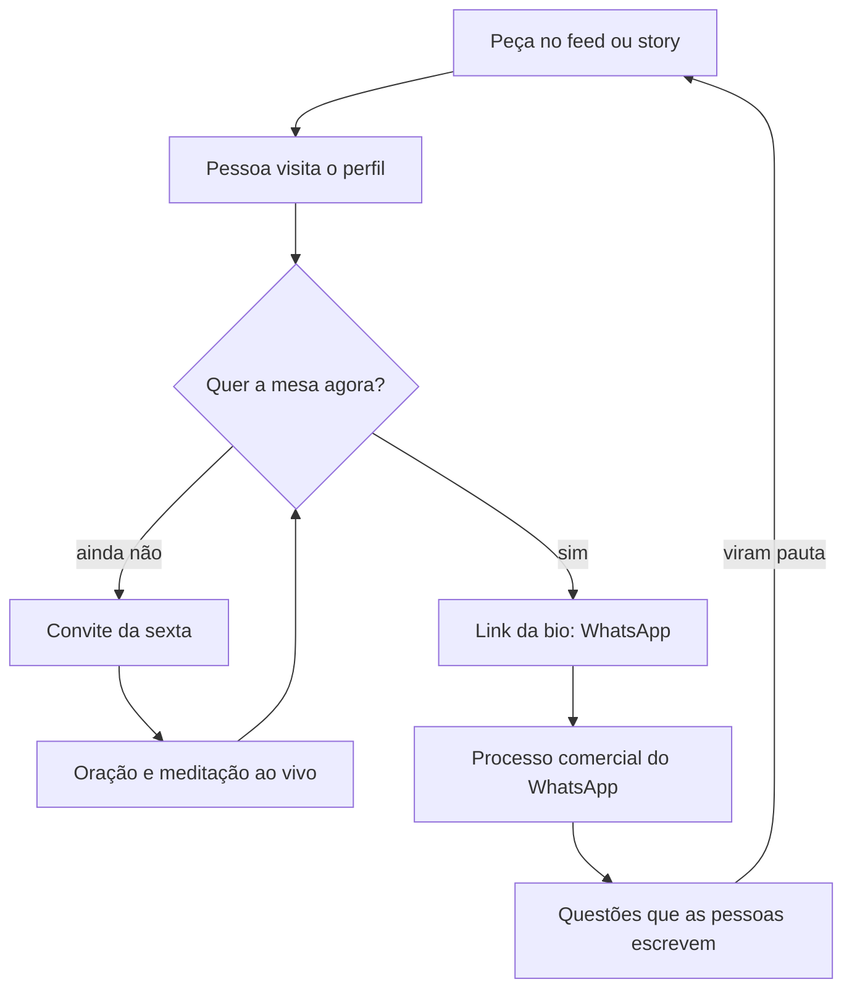

# PLANEJAMENTO DE CONTEÚDO · Paola Lopes Rosa · 13/10 a 01/11/2026

> **Tipo:** registro (plano) · **Feito em:** 12/10/2026 · **Pedido:** Victor (*"agora faz o planejamento de conteúdo dela"*) · compromisso N-4 da call
> **Método:** `10-skills/heads/head-conteudo.skill.md` (decide) → skill de copy, módulo 06 (linha editorial, sentimento antes do assunto, gate de conteúdo)
> **Status:** 🟡 **proposta, aguarda o Victor.** Ela ainda não viu. Peça para o público: rascunho de teste enquanto o P4 reprovar e o léxico não tiver fonte `D` (mesmo desvio declarado dos criativos).
> **O que este plano não é:** os roteiros palavra por palavra. Ele fecha pauta, pivô, título de tela e passo final de cada peça. Os roteiros são a entrega seguinte (N-3).

## 1. Decisão

**O conteúdo dela, agora, tem uma função: fazer o perfil confirmar o que o anúncio disse.** Quem clica no anúncio e não chama na hora vai olhar o perfil. Hoje encontra nove frentes. Vai passar a encontrar a mesa, explicada por ela, e a pessoa que ela é.

| Decidido | Por quê |
|---|---|
| **Três peças de feed por semana, em dias fixos, mais a sexta que ela já faz** | um celular, sem computador, e ela mesma descreve o próprio ritmo: *"eu vou com tudo… daqui a pouco eu vou assim, murchando"* (C-52). Ritmo que ela sustenta vale mais que volume |
| **Uma dor por semana, em três tempos** | é o que deixa a linha coerente sem repetir (módulo 06, §11.4). E cada semana espelha um dos dois anúncios, para o perfil e o anúncio dizerem a mesma coisa |
| **Só a mesa** | decisão de foco já tomada (DEC-PL-08) e aceita por ela: *"Tá ótimo."* |
| **A voz é a dela, com o humor** | *"Eu sou brincalhão"* · *"Total, espiritualista e cética. Porque eu desconfio de tudo."* É o que a separa do nicho (P3, crença 5) |
| **Depois de duas semanas, a pauta passa a nascer das conversas do WhatsApp** | é a primeira fonte direta da palavra de quem compra. Até lá, tudo aqui é relato dela sobre as clientes |

**Fora do feed neste período, com o porquê:** mandala, perfumes, mapa astral, registros akáshicos, curso de códigos e escola. São as frentes que tiraram a mesa do foco (C-36: *"por isso que eu já tenho esquecido da mesa"*). A Irmandade das Rosas continua nos destaques e na sexta.

**O que isso gera de dinheiro (régua do §9):** conteúdo aqui não é via de caixa. Ele serve à venda da mesa em dois pontos: quem vem do anúncio encontra confirmação, e a base de mil e poucos seguidores recebe o convite sem custo de mídia. São quatro passos até o pagamento: peça → perfil → link → conversa → Pix. **Quanto isso rende: `n=0`.** A mesa nunca foi vendida, e o plano não promete número.

## 2. De onde sai a pauta

Dor cruzada com a crença que a pessoa precisa ter (`PILARES.md` P3). Só entrou dor com fonte.

| Dor | Fonte e grau | Crença que a semana constrói |
|---|---|---|
| O relacionamento começa bem e desanda quando ia avançar | PL-LEX-01 · `R` (a Paola citando uma cliente) | 1 · o que se repete é padrão · 2 · entender não resolve · 3 · dá para ver de onde vem |
| Uma área da vida não anda e a lógica não explica | C-22 · voz da Paola | 2 · a causa não está no racional · 4 · a mesa faz a parte dela, a sua é agir |
| *"Tá, mas o que eu faço?"* depois do atendimento | PL-LEX-09 · `R` | 4 · e o jogo de baralho como resposta |
| *"Quero aprender a fazer"* em vez de passar por alguém | PL-LEX-08 · `R` | 5 · esta pessoa não te enrola (*"até hoje, eu não consegui fazer direito em mim"*) |

As duas primeiras são as semanas 1 e 2. As duas últimas ficam para as semanas 3 e 4, se as conversas do WhatsApp não trouxerem coisa melhor.

**As duas palavras** (`DECISOES.md`, DEC-PL-11): *equalizar* para o que falta na situação; *harmonizar* para o que o tratamento busca.

## 3. O ritmo da semana

| Dia | Feed | Stories |
|---|---|---|
| Segunda | **Reels falado · a cena** (reconhecimento) | repost do Reels + caixinha: *"qual é a sua questão?"* |
| Terça | | bastidor: mesa do dia, sem nome e sem a questão da pessoa |
| Quarta | **Reels falado · a virada** (reconhecimento ou autoridade) | repost do Reels · **gravação da semana seguinte, à tarde** |
| Quinta | | convite da sexta |
| Sexta | | **oração e meditação ao vivo** · lembrete com o link |
| Sábado | **Carrossel · o como** (autoridade ou conversão), arte nossa | resposta a uma pergunta da caixinha |
| Domingo | | livre |

**Proporção em duas semanas:** três peças de reconhecimento, duas de autoridade, uma de conversão, mais as duas sextas. Fica perto do 60 / 25 / 15 do método.

**Gravação:** um bloco por semana, quarta à tarde, horário que ela já tem livre. Dois Reels de 30 a 45 segundos, com o roteiro no teleprompter. Sem edição além do corte no começo e no fim e do título na tela.

## 4. Calendário

### Semana zero · 13 a 18/10 · arrumar a casa

| Quando | O quê | Quem |
|---|---|---|
| ter 13/10 | bio nova no ar (`BIO.md`) e link do WhatsApp com a mensagem pronta | Paola, com o texto nosso |
| qua 14/10 | gravar os destaques **A Mesa** (5 stories) e **Quem sou** · gravar os Reels 1 e 2 | Paola; roteiros nossos |
| qui 15/10 | stories de convite para a sexta | Paola |
| sex 16/10 | oração e meditação ao vivo `[HORÁRIO]` | Paola |
| até sáb 17/10 | fixar no topo do perfil o post *"adultos da nova era"*, até as peças novas existirem | Paola |

### Semana 1 · 19 a 25/10 · o relacionamento que não passa do começo *(espelha o anúncio 1)*

| # | Dia | Formato · camada | Sentimento | Título na tela | Pivô em uma frase | Passo final |
|---|---|---|---|---|---|---|
| 1 | seg 19/10 | Reels · reconhecimento | identificação | *Começa bem. Quando ia avançar, desanda.* | Uma hora é você que não quer, outra hora é a pessoa, **mas** mudou a pessoa e travou na mesma fase, **por isso** a pergunta deixa de ser "quem" e vira "o que se repete" | pergunta: *"em que fase o seu trava?"* |
| 2 | qua 21/10 | Reels · autoridade | surpresa | *Entender por que acabou não muda o próximo.* | Você entende cada término, **mas** entender é racional e a situação que ficou sem equalizar não está no racional, **por isso** eu começo medindo, e não conversando | salvar |
| 3 | sáb 24/10 | Carrossel, linha lisa · autoridade | curiosidade | *O que eu meço antes de qualquer mesa.* | Todo mundo fala em energia, **mas** eu desconfio de tudo, **por isso** antes de tratar eu meço a aura e os sete chakras e te passo o número `[EXEMPLO DE NÚMERO]` | link da bio |
| | sex 23/10 | Ao vivo · reconhecimento | | oração e meditação | | entrar no grupo gratuito |

### Semana 2 · 26/10 a 01/11 · a área que não anda *(espelha o anúncio 2)*

| # | Dia | Formato · camada | Sentimento | Título na tela | Pivô em uma frase | Passo final |
|---|---|---|---|---|---|---|
| 4 | seg 26/10 | Reels · reconhecimento | identificação | *Você faz a sua parte e uma área da sua vida não anda.* | Pela lógica já era para ter andado, **mas** quando a lógica não explica a causa não está no que você faz hoje, **por isso** fazer mais força não muda | pergunta: *"qual é a sua área?"* |
| 5 | qua 28/10 | Reels · reconhecimento | surpresa | *As pessoas não querem mudar. Elas querem que as coisas mudem.* | Você procura um atendimento esperando que ele resolva, **mas** nenhum atendimento age por você, **por isso** a minha mesa termina num jogo que mostra o que fazer | pergunta: *"o que você já sabe que precisa fazer?"* |
| 6 | sáb 31/10 | Carrossel, linha rica · conversão | aprendizado | *A Mesa Arcturiana, do começo ao fim.* | Você nunca viu por dentro o que acontece numa mesa, **mas** aqui cada passo tem nome, **por isso** eu te mostro os quatro: a questão, a medida, o tratamento, a devolutiva | *"me chama no link"* |
| | sex 30/10 | Ao vivo · reconhecimento | | oração e meditação | | entrar no grupo gratuito |

**Fixados no topo do perfil ao fim da semana 2:** a peça 6 (como funciona), a 3 (o que eu meço) e a 1 (a cena).

### 🔴 Calendário revisto em 12/10 (DEC-PL-18) · vale no lugar das linhas de Reels das semanas 1 e 2

O Victor pediu um segundo ângulo nos roteiros, além de relacionamento. **Os dois ângulos passam a alternar**, e a regra de uma dor por semana cede a isso. Os carrosséis de sábado (peças 3 e 6) não mudam.

| Grava | Posta | Roteiro | Ângulo · tempo | Título na tela |
|---|---|---|---|---|
| qua 14/10 | seg 19/10 | 1 | relacionamento · a cena | *Começa bem. Quando ia avançar, desanda.* |
| qua 14/10 | qua 21/10 | 3 | sensível e cansada · a cena | *Sensível demais e cansada sem entender por quê?* |
| qua 21/10 | seg 26/10 | 2 | relacionamento · a virada | *Entender por que acabou não muda o próximo.* |
| qua 21/10 | qua 28/10 | 4 | sensível e cansada · a virada | *Ser sensível não é o seu problema.* |

Roteiros: `ROTEIROS-REELS-01-02.md` e `ROTEIROS-REELS-03-04.md`. PDF para ela: `ROTEIROS-REELS-LOTE-01.pdf`. Carrosséis 3 e 6, texto e arte: `CARROSSEIS-03-06.md`. **As peças 4 e 5 das tabelas acima (a área que não anda) vão para a semana de 02/11.**

### Semanas 3 e 4 · 02 a 15/11 · fecham com dado

A pauta é refeita na leitura de 01/11, nesta ordem de preferência:

1. **As questões que as pessoas escreveram no WhatsApp**, com a frase delas.
2. **A peça que mais gerou resposta nas duas semanas**, desdobrada em série.
3. As duas dores que ficaram na fila (§2), com o Harmonia como resposta ao *"quero aprender"*.
4. Uma continuação do post *"adultos da nova era"*, que já provou interesse (quinhentas e poucas curtidas num perfil de mil e poucos seguidores).

## 5. De onde vem cada peça

| # | Fonte | Limite |
|---|---|---|
| 1 | PL-LEX-01, grau `R` | sem o detalhe de família do caso (R-12) |
| 2 | C-22: *"O problema não está no racional. Está no espiritual, está no emocional."* | não afirmar que a pessoa fez terapia (grau `I`) |
| 3 | C-20, passo 2 · `[19:28:19]` *"a aura aberta é uma aura desprotegida"* · `[20:48:58]` *"espiritualista e cética"* | o exemplo de número depende da resposta dela sobre a escala |
| 4 | C-22: *"a nossa vida não vai em uma determinada área e racionalmente. A gente não entende por quê"* | qual é a área, só a que as clientes levaram |
| 5 | `[20:02:18]`, frase literal dela · P3, crença 4 | dita com o humor dela, sem acusar quem assiste |
| 6 | C-20, C-06, C-23 · arte da linha rica já pronta, com os quatro quadros | sem preço até ela fechar o valor |
| sexta | C-30, C-35 | 🔴 **nada sobre a consciência que ela canaliza** (sigilo pedido por ela) |

**Vale para todas:** nenhum resultado prometido · o mentor não é promessa (C-21) · sem a palavra cura · nada de saúde.

## 6. O que olhar toda segunda

Quatro contagens, sem meta, porque não há base:

1. Salvamentos e envios de cada peça.
2. Respostas à pergunta final de cada peça.
3. Visitas ao perfil e toques no link.
4. Conversas que chegaram com *"Vim pelo seu Instagram"*. É a mensagem do link da bio, e separa quem veio do perfil de quem veio do anúncio.

**O que decide a pauta seguinte é a 2 e a 4.** As frases que as pessoas escreverem entram no banco de léxico com grau direto.

## 7. Quem faz o quê

| Nós | Ela |
|---|---|
| roteiros dos Reels, até a véspera da gravação | gravar no bloco de quarta |
| legendas e títulos de tela | publicar nos dias fixos |
| os dois carrosséis, nas linhas de arte dos anúncios | stories do dia |
| leitura de segunda e pauta da semana seguinte | mandar os números e os prints das respostas |

## 8. O que falta dela para este plano

Já está na mensagem de 12/10 (`04 - processo comercial/MSG-PAOLA-2026-10-12-B.md`): horário da sexta e link do grupo (item 9) · escala da aura (item 6) · @ do perfil (item 12) · foto de rosto (item 13).
**Novo, só deste plano:** o link do post *"adultos da nova era"*, para lermos os comentários.

## 9. Gate

| Régua (módulo 06, §11.6) | Resultado |
|---|---|
| Sentimento declarado antes do assunto, um por peça | ✅ §4 |
| Pivô em uma frase, por peça | ✅ §4 |
| Título de tela | ✅ §4 |
| Camada declarada e proporção coerente | ✅ §3 |
| Um passo final só | ✅ §4 |
| Rodada declarada | ✅ exploração: seis pivôs distintos |
| Pauta nascida de dor com ID | ✅ §2 |
| 🔴 Bloco de espelho com ID e grau | ⚠️ peças 1 e 4 são de identificação e se apoiam em grau `R` e na voz da Paola. **Desvio declarado:** o léxico tem zero `D`. Sai como rascunho de teste e é a primeira coisa a trocar quando as conversas chegarem |
| REGRA Nº 0 | ✅ estrutura decidida; o §8 só pede fato |
| P4 reprovando | ⚠️ o plano não cita preço, comunidade, formato nem pagamento |
| Voz e anti-slop | ficam para os roteiros; aqui só há título e pivô |

---
*Feito em 12/10/2026 por Claude Code CLI. Decisão registrada em `DECISOES.md`, DEC-PL-14.*
